  

  
  
  
  

  
  
  
  

 

I build software across the whole stack: **native and cross-platform mobile** (Flutter, Swift, Kotlin and more), **backends and web**, and **AI systems**. Alongside product work I build the **engineering tooling that keeps AI-assisted code trustworthy**: linters, audits, regression tests and guardrails, covering the path from design system to store build.

 

One toolchain, five stages. Each tool plugs into the next.

 

Merged into the tools the Flutter ecosystem runs on. Every link is a PR or commit you can verify.

| Project | Contribution | Link |
|:--|:--|:--|
| **[flutter/flutter](https://github.com/flutter/flutter)** | Support multi-view apps in widget test binding | [PR #194480](https://github.com/flutter/flutter/pull/194480) · [`74a1f4dc`](https://github.com/flutter/flutter/commit/74a1f4dc) |
| **[flutter/devtools](https://github.com/flutter/devtools)** | Adjust ANSI colors in logs and console for theme legibility | [PR #10060](https://github.com/flutter/devtools/pull/10060) · [`b20573fe`](https://github.com/flutter/devtools/commit/b20573fe) |
| **[kiwix/kiwix-android](https://github.com/kiwix/kiwix-android)** | 8 patches: OPDS search fixes, category dialog UX, TOC gating | [commits](https://github.com/kiwix/kiwix-android/commits?author=81323680%2Bawaisdev5765%40users.noreply.github.com) |

Full list: <a href="https://github.com/Awaisdev01/contributions"><code>Awaisdev01/contributions</code></a>

 

<table>
  <tr>
    <td width="33%" valign="top">
      <h4>Design to code</h4>
      <a href="https://github.com/Awaisdev01/nativetap"><b>nativetap</b></a> 
      464 mobile design rules (HIG, Material 3, Flutter, SwiftUI, Compose) that your AI agent searches before it writes a screen.  
      <a href="https://github.com/Awaisdev01/prism_sketch"><b>prism_sketch</b></a> 
      Wireframe-to-code for the Prism pipeline.
    </td>
    <td width="33%" valign="top">
      <h4>Code quality</h4>
      <a href="https://github.com/Awaisdev01/prism_doctor"><b>prism_doctor</b></a>: A–F audits for Dart and Flutter 
      <a href="https://github.com/Awaisdev01/prism_lints"><b>prism_lints</b></a>: design-system lints at compile time 
      <a href="https://github.com/Awaisdev01/prism_guardrails"><b>prism_guardrails</b></a>: safety layer for agent-built Dart 
      <a href="https://github.com/Awaisdev01/diffconscience"><b>diffconscience</b></a>: audit of AI diffs before handoff 
      <a href="https://github.com/Awaisdev01/bashproof"><b>bashproof</b></a>: quoting-trap protection for shell commands
    </td>
    <td width="33%" valign="top">
      <h4>AI and ML</h4>
      <a href="https://github.com/Awaisdev01/promptguard"><b>promptguard</b></a>: prompt regression tests in CI across OpenAI, Anthropic, Gemini and Groq  
      <a href="https://github.com/Awaisdev01/factcheck"><b>factcheck</b></a>: CI gate for AI-written claims. Zero dependencies, no LLM  
      <a href="https://github.com/Awaisdev01/forgecode"><b>forgecode</b></a>: agent core with a streaming client, tool loop and workspace tools
    </td>
  </tr>
  <tr>
    <td valign="top">
      <h4>Ship</h4>
      <a href="https://github.com/Awaisdev01/shipcheck"><b>shipcheck</b></a> 
      Launch-readiness audit: store listings, privacy, screenshots, release notes.
    </td>
    <td colspan="2" valign="top">
      <h4>Products</h4>
      <a href="https://github.com/Awaisdev01/smsaria"><b>smsaria</b></a>: AI for any phone. Turns a phone number into an AI service over SMS and USSD, including basic feature phones. 
      <a href="https://github.com/Awaisdev01/stfu-2.0"><b>stfu-2.0</b></a>: noise, your rules (<a href="https://awaisdev01.github.io/stfu-2.0/">live app</a>) 
      <a href="https://github.com/Awaisdev01/urdu_toolkit"><b>urdu_toolkit</b></a>: Urdu and RTL text utilities for Flutter: transliteration, Nastaliq
    </td>
  </tr>
</table>

How **[smsaria](https://github.com/Awaisdev01/smsaria)** works: a phone number becomes an AI service, so people on basic feature phones can use it over SMS or USSD.

 

A Flutter design system and component suite, published on [pub.dev](https://pub.dev/packages?q=prism). The flagship is **[`prism_kit`](https://github.com/Awaisdev01/prism_kit)** (`2.1.1`): 51 adaptive components on a shared design system, covering tables, calendar, tabs, forms and an AI chat client.

<b>Browse the other packages</b>

 

| Package | Description | Version |
|:--|:--|:-:|
| [`prism_glass`](https://github.com/Awaisdev01/prism_glass) | Apple's Liquid Glass material, backported to Flutter | `0.1.0` |
| [`prism_sketch`](https://github.com/Awaisdev01/prism_sketch) | Wireframe-to-code for the Prism pipeline | `0.1.0` |
| [`prism_alerts`](https://github.com/Awaisdev01/prism_alerts) | Local reminders that survive DST, timezone changes and reboots | `0.1.0` |
| [`prism_markdown`](https://github.com/Awaisdev01/prism_markdown) | Fast, plugin-free Markdown widget (CommonMark and GFM) | `0.4.0` |
| [`prism_form`](https://github.com/Awaisdev01/prism_form) | Declarative forms: typed fields, composable validators, sealed results | `0.1.0` |
| [`prism_toast`](https://github.com/Awaisdev01/prism_toast) | Adaptive toasts: bottom on mobile, stacked on desktop | `0.1.0` |
| [`prism_banner`](https://github.com/Awaisdev01/prism_banner) | Dismissible in-app announcement banners | `0.1.0` |
| [`prism_ai`](https://github.com/Awaisdev01/prism_ai) | Provider-agnostic streaming AI chat client (OpenAI, Ollama and more) | `0.6.0` |
| [`prism_updater`](https://github.com/Awaisdev01/prism_updater) | Cross-platform in-app update experience | `0.2.0` |

 

| Where | What |
|:--|:--|
| **Google Play** | [Airtech Solutions](https://play.google.com/store/apps/developer?id=Airtech_Solutions&hl=en) and [more published apps](https://play.google.com/store/apps/dev?id=7092025414115875044&hl=en) |
| **App Store** | [ATG Middle East Company W.L.L.](https://apps.apple.com/pk/developer/atg-middle-east-company-w-l-l/id1764554258) |
| **Medium** | [Articles on Flutter, AI tooling and engineering](https://medium.com/@awaiscs) |
| **CodeCanyon** | [App templates and source code](https://codecanyon.net/author_dashboard) |
| **Magnific** | [Author portfolio](https://www.magnific.com/author/awaisdev5765) |

 

 

AI summaries sound confident even when they are wrong. This small game is built around the idea behind [`factcheck`](https://github.com/Awaisdev01/factcheck): compare AI-written text with a facts file and catch what the facts don't support.

 

  
  

  

 

  
  
  
  
  
  

Formerly <a href="https://github.com/awaisdev5765"><code>awaisdev5765</code></a>. All ongoing work lives here; earlier work is preserved in the repos above and in <a href="https://github.com/Awaisdev01/contributions">merged upstream commits</a>.

<!-- Old account: awaisdev5765 (suspended Nov 2026). This account carries all ongoing work. -->
