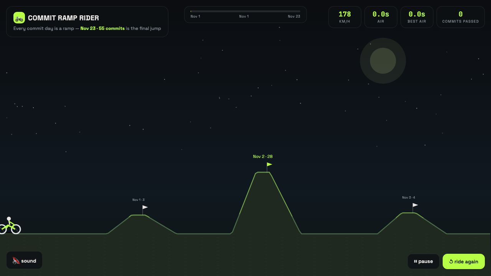

<h1 align="center">Awais Ur Rehman</h1>
<h3 align="center">Senior Mobile Engineer & Full-Stack + AI Developer</h3>

  <b>🌐 <a href="https://awaisdev01.github.io/Awaisdev01/">My portfolio site</a></b> — live GitHub stats, every project, and the game.

  <i>Flutter & Swift apps · Dart/TypeScript backends · AI agents and ML-powered features — from design system to shipped store build.</i>

  
  

> [!IMPORTANT]
> **My previous account [`awaisdev5765`](https://github.com/awaisdev5765) was deactivated/suspended (Nov 2026).** This is my new home — everything continues here. The work didn't disappear: it lives in the repos below and in [merged commits on upstream `main` branches](https://github.com/Awaisdev01/contributions).

I build the **missing tooling for the AI-coding era** — a full pipeline, not one-off scripts:

**📱 Design → 🔬 Code → ✅ Claims → 🧪 AI features → 🚢 Ship**

The game above? **Commit Ramp Rider** — I turned my commit history into a dirt-bike track: every commit day became a hill, the bigger the day the bigger the ramp. Plain JavaScript, custom physics & sound, zero game engine. [**Play it live →**](https://awaisdev01.github.io/commit-ramp-rider/)

---

### 📊 GitHub stats

  
  

  

  

### 🏆 Open-source contributor

My work is merged in the tools you already use:

| Project | Contribution |
|---|---|
| **flutter/flutter** | Support for multi-view apps in widget test binding — [`74a1f4dc`](https://github.com/flutter/flutter/commit/74a1f4dc) on `master` |
| **flutter/devtools** | ANSI color legibility fix for logs & console — [`b20573fe`](https://github.com/flutter/devtools/commit/b20573fe) on `master` |
| **kiwix/kiwix-android** | 8 landed patches: OPDS search fixes, category dialog UX, TOC gating — [commits on `main`](https://github.com/kiwix/kiwix-android/commits?author=81323680%2Bawaisdev5765%40users.noreply.github.com) |

Every link is a commit you can click and verify. Full list → [`Awaisdev01/contributions`](https://github.com/Awaisdev01/contributions)

---

### 🧰 The pipeline — my own tools

#### 📱 Design → code
- [`nativetap`](https://github.com/Awaisdev01/nativetap) — **464 mobile-design rules** (HIG, Material 3, Flutter, SwiftUI, Compose) your AI agent searches before writing any phone screen UI

#### 🔬 Code quality
- [`prism_doctor`](https://github.com/Awaisdev01/prism_doctor) — scored A–F audits for Dart/Flutter: hardcoded colors, magic numbers, dead code
- [`prism_lints`](https://github.com/Awaisdev01/prism_lints) — custom analyzer lints that catch design-system violations at compile time
- [`prism_guardrails`](https://github.com/Awaisdev01/prism_guardrails) — the AI safety layer for agent-built Dart code
- [`diffconscience`](https://github.com/Awaisdev01/diffconscience) — pre-handoff audit of AI agent diffs (leftover debug code, secrets, TODOs)
- [`bashproof`](https://github.com/Awaisdev01/bashproof) — stops AI-generated shell commands from breaking on quoting traps

#### 🧠 AI / ML
- [`promptguard`](https://github.com/Awaisdev01/promptguard) — **regression testing for AI features** across OpenAI/Anthropic/Gemini/Groq — catch prompt regressions in CI before users do
- [`factcheck`](https://github.com/Awaisdev01/factcheck) — **the CI gate for AI-written content**: verify claims in AI text against a facts file you control. Zero deps, no LLM
- [`forgecode`](https://github.com/Awaisdev01/forgecode) — **AI agent core** with streaming LLM client, tool-call loop and workspace tools — one core, four platforms (web, Electron, VS Code)

#### 🚢 Ship
- [`shipcheck`](https://github.com/Awaisdev01/shipcheck) — launch-readiness audit: store listings, privacy, screenshots, release notes

---

### 🧩 The Prism ecosystem — 15 packages on pub.dev

**Core:**

| Package | What it is |
|---|---|
| [`prism_kit`](https://github.com/Awaisdev01/prism_kit) | **51 adaptive components** on a shared design system — tables, calendar, tabs, forms, AI chat client · `2.1.1` |
| [`prism_glass`](https://github.com/Awaisdev01/prism_glass) | Apple's **Liquid Glass** material, backported to Flutter |
| [`prism_sketch`](https://github.com/Awaisdev01/prism_sketch) | Wireframe-to-code for the Prism pipeline |
| [`prism_alerts`](https://github.com/Awaisdev01/prism_alerts) | Local reminders that survive DST, timezone changes and reboots |

**UI components:**

| Package | What it is |
|---|---|
| [`prism_markdown`](https://github.com/Awaisdev01/prism_markdown) | Fast, plugin-free Markdown widget (full CommonMark + GFM) · `0.4.0` |
| [`prism_form`](https://github.com/Awaisdev01/prism_form) | Declarative forms — typed fields, composable validators, sealed results · `0.1.0` |
| [`prism_toast`](https://github.com/Awaisdev01/prism_toast) | Adaptive toast notifications — bottom on mobile, stacked on desktop · `0.1.0` |
| [`prism_banner`](https://github.com/Awaisdev01/prism_banner) | Dismissible in-app announcement banners · `0.1.0` |

**AI & platform:**

| Package | What it is |
|---|---|
| [`prism_ai`](https://github.com/Awaisdev01/prism_ai) | Provider-agnostic streaming AI chat client (OpenAI, Ollama…) · `0.6.0` |
| [`prism_updater`](https://github.com/Awaisdev01/prism_updater) | Cross-platform in-app update experience · `0.2.0` |

---

### ⚡ Products

- [`smsaria`](https://github.com/Awaisdev01/smsaria) — **AI for any phone**: turns a phone number into an AI service over SMS/USSD (works on basic feature phones)
- [`stfu-2.0`](https://github.com/Awaisdev01/stfu-2.0) — noise, your rules · [live app](https://awaisdev01.github.io/stfu-2.0/)
- [`urdu_toolkit`](https://github.com/Awaisdev01/urdu_toolkit) — Urdu & RTL text utilities for Flutter (transliteration, Nastaliq)

---

### 🛠️ Stack

  
  
  
  
  
  
  

  <b>AI / ML:</b>
  
  
  
  
  
  
  
  

  <b>Backend & cloud:</b>
  
  
  
  
  
  
  

### 📫 Find me

- pub.dev: [all 15 packages](https://pub.dev/packages?q=prism)
- Issues and PRs welcome on any repo above

<!-- Old account: awaisdev5765 (suspended Nov 2026). This account carries all ongoing work. -->
