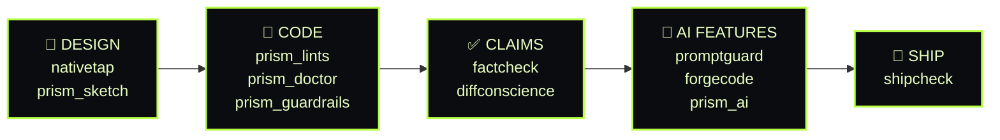

<!-- ═══════════════════════════ HERO ═══════════════════════════ -->

  

  
  
  
  

  
  
  
  

  
  
  
  

 

<!-- ═══════════════════════════ ABOUT ═══════════════════════════ -->
## ◼ About

I design and ship **production mobile apps** and build the **engineering tooling that keeps AI-assisted code trustworthy**: linters, audits, regression tests and guardrails, covering the path from design system to store build.

<table>
  <tr>
    <td width="25%" valign="top" align="center"><h3>📱</h3><b>Mobile</b> Flutter, Swift, Kotlin Adaptive design systems Store-ready releases</td>
    <td width="25%" valign="top" align="center"><h3>🧠</h3><b>AI Systems</b> Agents &amp; tool-call loops Multi-provider LLM clients Prompt regression testing</td>
    <td width="25%" valign="top" align="center"><h3>🛡️</h3><b>Code Trust</b> Custom analyzer lints Scored code audits Claim verification in CI</td>
    <td width="25%" valign="top" align="center"><h3>⚙️</h3><b>Full-Stack</b> Dart &amp; TypeScript backends Realtime &amp; SMS/USSD services Cloud-native deploys</td>
  </tr>
</table>

 

<!-- ═══════════════════════════ PIPELINE ═══════════════════════════ -->
## ◼ The Pipeline

One toolchain, five stages. Each tool I build plugs into the next.

 

<!-- ═══════════════════════════ OPEN SOURCE ═══════════════════════════ -->
## ◼ Open-Source Contributions

Merged into the tools the Flutter ecosystem runs on. Every link is a commit you can verify.

| Project | Contribution | Commit |
|:--|:--|:--|
| **[flutter/flutter](https://github.com/flutter/flutter)** | Multi-view app support in the widget test binding | [`74a1f4dc`](https://github.com/flutter/flutter/commit/74a1f4dc) |
| **[flutter/devtools](https://github.com/flutter/devtools)** | ANSI color legibility fix for logs & console | [`b20573fe`](https://github.com/flutter/devtools/commit/b20573fe) |
| **[kiwix/kiwix-android](https://github.com/kiwix/kiwix-android)** | 8 patches: OPDS search fixes, category dialog UX, TOC gating | [view commits](https://github.com/kiwix/kiwix-android/commits?author=81323680%2Bawaisdev5765%40users.noreply.github.com) |

Full list → <a href="https://github.com/Awaisdev01/contributions"><code>Awaisdev01/contributions</code></a>

 

<!-- ═══════════════════════════ TOOLING ═══════════════════════════ -->
## ◼ Developer Tooling

<table>
  <tr>
    <td width="33%" valign="top">
      <h4>📱 Design → Code</h4>
      <a href="https://github.com/Awaisdev01/nativetap"><b>nativetap</b></a> 
      464 mobile design rules (HIG, Material 3, Flutter, SwiftUI, Compose) that your AI agent searches before writing any screen.
        
      <a href="https://github.com/Awaisdev01/prism_sketch"><b>prism_sketch</b></a> 
      Wireframe-to-code for the Prism pipeline.
    </td>
    <td width="33%" valign="top">
      <h4>🔬 Code Quality</h4>
      <a href="https://github.com/Awaisdev01/prism_doctor"><b>prism_doctor</b></a>: A–F audits for Dart/Flutter 
      <a href="https://github.com/Awaisdev01/prism_lints"><b>prism_lints</b></a>: design-system lints at compile time 
      <a href="https://github.com/Awaisdev01/prism_guardrails"><b>prism_guardrails</b></a>: safety layer for agent-built Dart 
      <a href="https://github.com/Awaisdev01/diffconscience"><b>diffconscience</b></a>: pre-handoff audit of AI diffs 
      <a href="https://github.com/Awaisdev01/bashproof"><b>bashproof</b></a>: quoting-trap protection for shell commands
    </td>
    <td width="33%" valign="top">
      <h4>🧠 AI / ML</h4>
      <a href="https://github.com/Awaisdev01/promptguard"><b>promptguard</b></a>: prompt regression tests in CI across OpenAI, Anthropic, Gemini, Groq 
      <a href="https://github.com/Awaisdev01/factcheck"><b>factcheck</b></a>: CI gate for AI-written claims. Zero deps, no LLM 
      <a href="https://github.com/Awaisdev01/forgecode"><b>forgecode</b></a>: agent core with streaming client, tool loop and workspace tools
    </td>
  </tr>
  <tr>
    <td colspan="3" valign="top">
      <h4>🚢 Ship</h4>
      <a href="https://github.com/Awaisdev01/shipcheck"><b>shipcheck</b></a>: launch-readiness audit covering store listings, privacy, screenshots and release notes
    </td>
  </tr>
</table>

 

<!-- ═══════════════════════════ PRISM ═══════════════════════════ -->
## ◼ The Prism Ecosystem

A Flutter design system and component suite, published on [pub.dev](https://pub.dev/packages?q=prism).

<table>
  <tr>
    <th align="left">Package</th>
    <th align="left">Description</th>
    <th>Version</th>
  </tr>
  <tr><td colspan="3"><b>CORE</b></td></tr>
  <tr><td><a href="https://github.com/Awaisdev01/prism_kit"><code>prism_kit</code></a></td><td>51 adaptive components on a shared design system: tables, calendar, tabs, forms, AI chat client</td><td align="center"></td></tr>
  <tr><td><a href="https://github.com/Awaisdev01/prism_glass"><code>prism_glass</code></a></td><td>Apple's Liquid Glass material, backported to Flutter</td><td align="center">—</td></tr>
  <tr><td><a href="https://github.com/Awaisdev01/prism_sketch"><code>prism_sketch</code></a></td><td>Wireframe-to-code for the Prism pipeline</td><td align="center">—</td></tr>
  <tr><td><a href="https://github.com/Awaisdev01/prism_alerts"><code>prism_alerts</code></a></td><td>Local reminders that survive DST, timezone changes and reboots</td><td align="center">—</td></tr>
  <tr><td colspan="3"><b>UI COMPONENTS</b></td></tr>
  <tr><td><a href="https://github.com/Awaisdev01/prism_markdown"><code>prism_markdown</code></a></td><td>Fast, plugin-free Markdown widget (CommonMark + GFM)</td><td align="center"></td></tr>
  <tr><td><a href="https://github.com/Awaisdev01/prism_form"><code>prism_form</code></a></td><td>Declarative forms: typed fields, composable validators, sealed results</td><td align="center"></td></tr>
  <tr><td><a href="https://github.com/Awaisdev01/prism_toast"><code>prism_toast</code></a></td><td>Adaptive toasts: bottom on mobile, stacked on desktop</td><td align="center"></td></tr>
  <tr><td><a href="https://github.com/Awaisdev01/prism_banner"><code>prism_banner</code></a></td><td>Dismissible in-app announcement banners</td><td align="center"></td></tr>
  <tr><td colspan="3"><b>AI &amp; PLATFORM</b></td></tr>
  <tr><td><a href="https://github.com/Awaisdev01/prism_ai"><code>prism_ai</code></a></td><td>Provider-agnostic streaming AI chat client (OpenAI, Ollama…)</td><td align="center"></td></tr>
  <tr><td><a href="https://github.com/Awaisdev01/prism_updater"><code>prism_updater</code></a></td><td>Cross-platform in-app update experience</td><td align="center"></td></tr>
</table>

 

<!-- ═══════════════════════════ PRODUCTS ═══════════════════════════ -->
## ◼ Products

<table>
  <tr>
    <td width="33%" valign="top">
      <h4><a href="https://github.com/Awaisdev01/smsaria">smsaria</a></h4>
      <b>AI for any phone.</b> Turns a phone number into an AI service over SMS/USSD, working on basic feature phones.
    </td>
    <td width="33%" valign="top">
      <h4><a href="https://github.com/Awaisdev01/stfu-2.0">stfu-2.0</a></h4>
      Noise, your rules. <a href="https://awaisdev01.github.io/stfu-2.0/">Live app →</a>
    </td>
    <td width="33%" valign="top">
      <h4><a href="https://github.com/Awaisdev01/urdu_toolkit">urdu_toolkit</a></h4>
      Urdu &amp; RTL text utilities for Flutter: transliteration, Nastaliq.
    </td>
  </tr>
</table>

 

<!-- ═══════════════════════════ TECH STACK ═══════════════════════════ -->
## ◼ Tech Stack

<table>
  <tr>
    <td width="170" valign="middle"><b>📱 Mobile</b></td>
    <td>
       
      
      
      
      
      
      
      
    </td>
  </tr>
  <tr>
    <td valign="middle"><b>💻 Languages</b></td>
    <td></td>
  </tr>
  <tr>
    <td valign="middle"><b>🌐 Web &amp; Backend</b></td>
    <td>
       
      
      
      
      
      
    </td>
  </tr>
  <tr>
    <td valign="middle"><b>🧠 AI / LLM</b></td>
    <td>
      
      
      
      
      
      
      
      
      
      
    </td>
  </tr>
  <tr>
    <td valign="middle"><b>📊 ML</b></td>
    <td>
      
      
      
      
    </td>
  </tr>
  <tr>
    <td valign="middle"><b>🗄️ Data</b></td>
    <td></td>
  </tr>
  <tr>
    <td valign="middle"><b>☁️ Cloud &amp; DevOps</b></td>
    <td></td>
  </tr>
  <tr>
    <td valign="middle"><b>🧰 Tools</b></td>
    <td></td>
  </tr>
</table>

<b>Engineering practices</b>

 

`Clean Architecture` · `Design Systems` · `Adaptive / Responsive UI` · `Accessibility` · `Static Analysis & Custom Lints` · `CI/CD` · `Prompt Regression Testing` · `Agentic Workflows` · `Offline-first` · `i18n / RTL` · `Release Engineering` · `Performance Profiling`

 

<!-- ═══════════════════════════ PUBLISHED APPS ═══════════════════════════ -->
## ◼ Published Apps

Shipped to production on both stores.

<table>
  <tr>
    <td width="33%" valign="top" align="center">
      <h4>🤖 Google Play</h4>
      <b>Airtech Solutions</b> 
      Developer portfolio  
      
    </td>
    <td width="33%" valign="top" align="center">
      <h4>🤖 Google Play</h4>
      <b>Developer page</b> 
      Additional published apps  
      
    </td>
    <td width="33%" valign="top" align="center">
      <h4>🍎 App Store</h4>
      <b>ATG Middle East Company W.L.L.</b> 
      Developer portfolio  
      
    </td>
  </tr>
</table>

 

<!-- ═══════════════════════════ WRITING & MARKETPLACES ═══════════════════════════ -->
## ◼ Writing & Marketplaces

<table>
  <tr>
    <td width="33%" valign="top" align="center">
      <h4>✍️ Medium</h4>
      Articles on Flutter, AI tooling and engineering  
      
    </td>
    <td width="33%" valign="top" align="center">
      <h4>🛒 CodeCanyon</h4>
      Premium app templates &amp; source code  
      
    </td>
    <td width="33%" valign="top" align="center">
      <h4>🎨 Magnific</h4>
      Author portfolio  
      
    </td>
  </tr>
</table>

 

<!-- ═══════════════════════════ GAME ═══════════════════════════ -->
## ◼ Side Project: Commit Ramp Rider

My commit history as a dirt-bike track: every commit day is a hill, the bigger the day the bigger the ramp. Plain JavaScript, custom physics and sound, zero game engine. **[Play it live →](https://awaisdev01.github.io/commit-ramp-rider/)**

 

<!-- ═══════════════════════════ ACTIVITY ═══════════════════════════ -->
## ◼ GitHub Activity

  
  

  

  

  

  

 

<!-- ═══════════════════════════ CONNECT ═══════════════════════════ -->
## ◼ Connect

  
  
  
  

  
  
  
  
  

Issues and PRs are welcome on any repo above.

Formerly <a href="https://github.com/awaisdev5765"><code>awaisdev5765</code></a>. All ongoing work lives here; earlier work is preserved in the repos above and in <a href="https://github.com/Awaisdev01/contributions">merged upstream commits</a>.

<!-- Old account: awaisdev5765 (suspended Nov 2026). This account carries all ongoing work. -->
